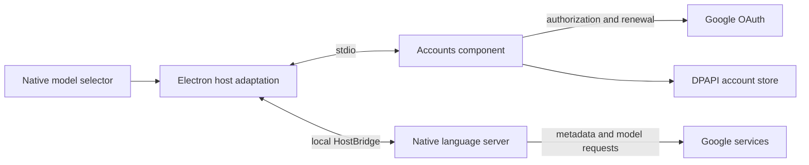

# Architecture

Antigravity Accounts adds independently authorized accounts to the native model selector in one Antigravity window. The desktop host and its language server remain responsible for model requests. This repository contains the account component, host adaptation and installation tooling; former Profile Hub applications remain in [Git history](docs/HISTORY.md).

## Components

| Location | Responsibility |
| --- | --- |
| `src/Antigravity.Accounts` | .NET 10 stdio service: Google web authorization, encrypted storage, primary/secondary relationships, token renewal and selection transactions |
| `packages/hostauth-adapter/src` | Electron/HostBridge integration, native menu groups, submission control, native identity/project confirmation and compatibility checks |
| `packages/account-plugin` | Plugin metadata, installation, restoration, cached update repair and external update handoff |
| `tests/Antigravity.Accounts.Tests` | Component checks using temporary stores and controlled OAuth implementations |
| `packages/*/test` | Node tests for the host, menu, installation and updates; some cases require separately supplied official program files |
| `scripts` | SDK selection, builds, distribution packaging and package-content checks |

The renderer receives account summaries and operation status, not access or refresh tokens. HostBridge uses a newly generated local bridge credential. The native language server receives tokens for the independently selected account; the original saved official login is not imported.

## Account changes

The component tracks a unique primary account, selected account and selection generation. A switch starts with the expected generation and returns a transaction ticket; stale or conflicting commits are rejected. The host blocks new submissions, waits for native work to finish and drains token callbacks before committing. Native identity, project, model and quota confirmation must finish before new submissions resume.

Active generation, tools, background work, remote control or sleeping schedules can delay a switch. Unreadable work state or failed metadata confirmation leaves sending paused. Cancelling the wait does not cancel native tasks. The host captures each window's model before changing accounts and restores it when available. Otherwise that window requires an explicit native model selection.

Deleting a non-selected secondary account removes its local authorization. The running host rejects deletion of the selected account or primary account and blocks deletion during authorization or switching. This operation does not delete a Google account.

## Native compatibility

The current reviewed program profiles are Antigravity 2.29.0 and 2.28.2. Installation checks seven complete related host/updater scripts, RPC dependencies and native-program contents. A package version change can be accepted when those contracts remain compatible. Unknown checked-interface or native-program changes are refused. Frontend bindings are found through protobuf schemas, Redux actions, selectors and providers rather than fixed compiler variable names.

Installation changes the official `app.asar` to add host and session-preload hooks. A language-server copy exposes only the goroutine diagnostic route used for task-state checks; the independent-account copy additionally changes one project-cache call to the matching native refresh function. The original-login path does not use that project-cache change. Global dev mode and other pprof routes are not enabled. Official program copies are generated locally and excluded from release packages.

## Installation and local data

The default state directory is `%LOCALAPPDATA%/AntigravityAccounts`. Credentials are stored with Windows DPAPI CurrentUser. Installation records the resolved directory as `accountsStateRoot`, and the component receives it through `--data-root`. Installation, ordinary startup and repair therefore use the same directory even when Windows maps the installing process's LocalAppData differently.

The directory also contains `adapter-installation.json`, `restore-*` original-program directories, prepared files and independent `recovery-package-*` caches. Restoration checks both current installed programs before replacing either. A mismatched official update is not overwritten with an older original.

A Windows installation lock serializes install, restore and repair. Repair waits for the desktop, language server and updater to stop. The in-app updater prepares an external waiting process before installation; it waits for the old app and installer to exit and for files to stop changing, then invokes the registered repair/start entry. It does not read credentials. Actual NSIS upgrade behavior remains unverified; the waiting and invocation logic has been checked with controlled processes.

Chinese localization is an optional external integration. Where present, its launcher coordinates repair order. For a manual Accounts change, restore the Chinese layer first, change Accounts, then reapply Chinese localization. This repository does not distribute that toolkit.

## Build and distribution

The Accounts project file is the version source. `global.json` selects .NET SDK 10.0.400. NuGet lock files cover ordinary builds and self-contained Windows x64 publishing. The distribution contains the compressed component, host/installer scripts, plugin metadata, license and usage/validation documents. It excludes official programs, account stores and debug symbols.

The manifest describes the preview but does not load the host adaptation by itself. Accounts requires the complete Windows distribution and local installation; Marketplace submission does not mean listing. See [usage](docs/ACCOUNTS_PLUGIN.md), [validation scope](docs/ACCOUNTS_VALIDATION.md) and [submission history](docs/ACCOUNTS_MARKETPLACE_REQUEST.md).
