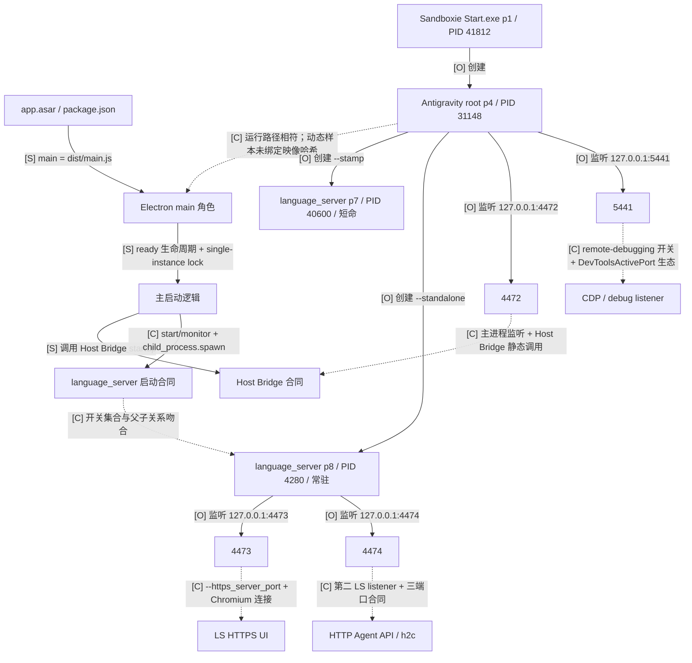
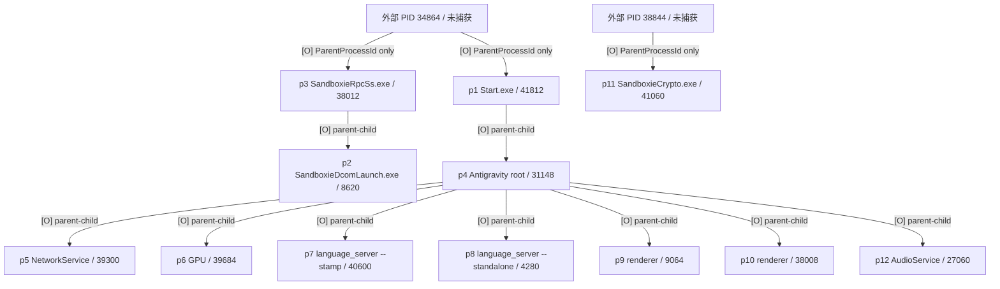
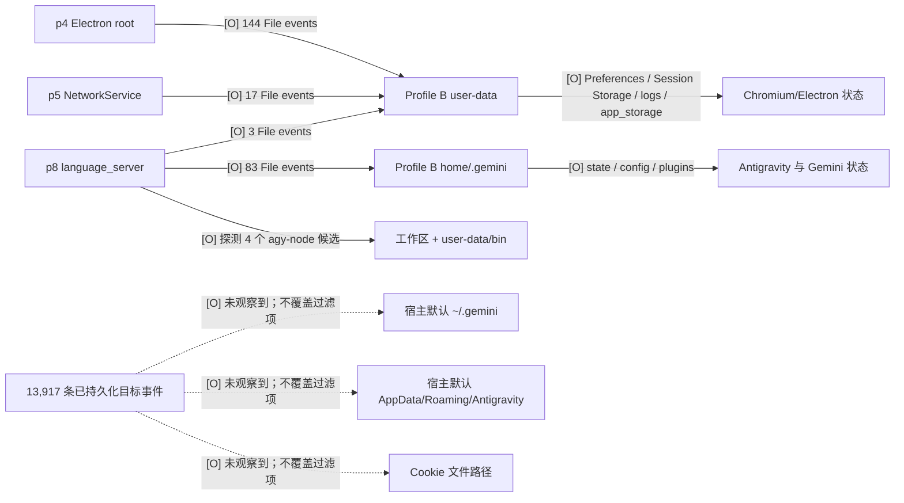
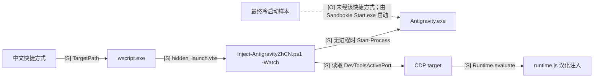
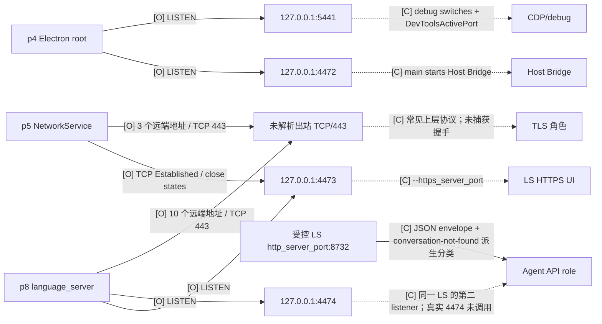
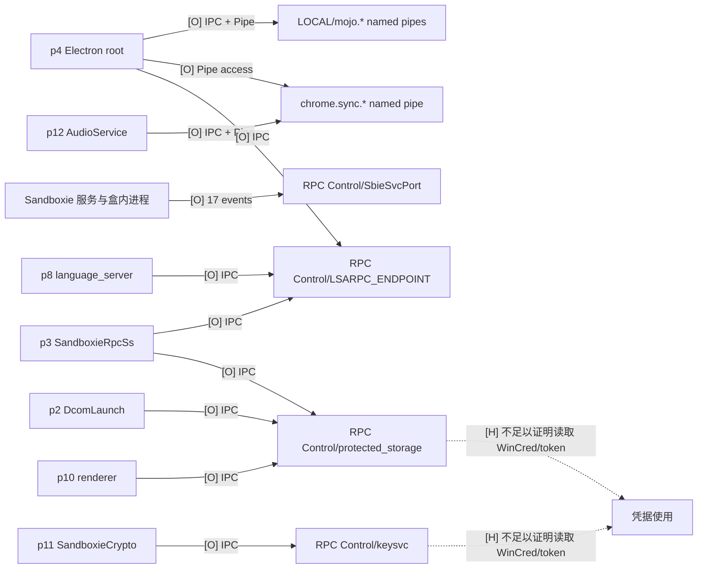
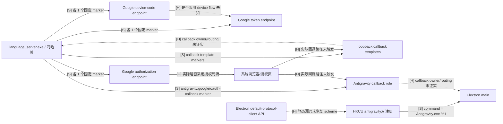
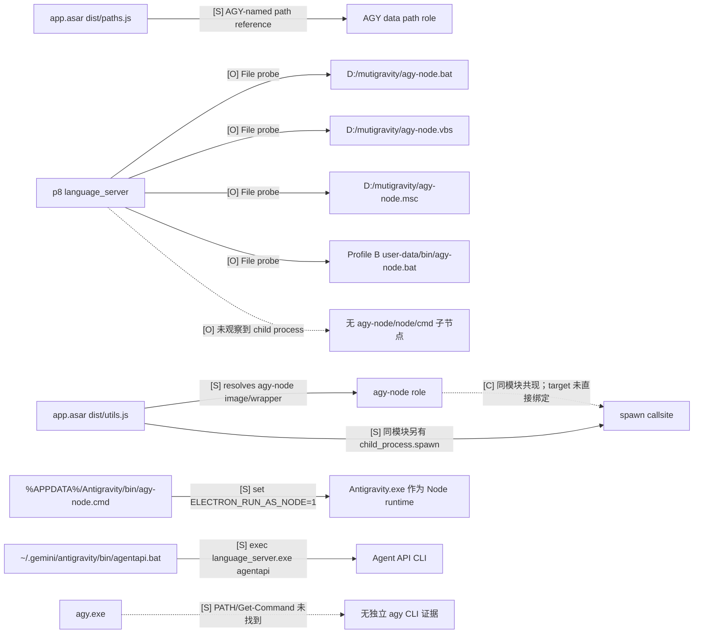

# Antigravity 2.12.2 只读运行取证报告

> 取证窗口：2026-09-08 至 2026-09-09（Asia/Shanghai）  
> 阶段状态：**只读取证节点完成；已暂停在核心功能实现之前。**  
> 适用对象：Windows 版 Antigravity Desktop 2.12.2 / 文件版本 2.12.2.0。  
> “完整”在本文中指采集窗口内全部已观测进程节点及已保留关系；受采样、Sandboxie monitor 类型支持和脱敏限制，不代表无损系统调用追踪。

## 1. 结论

1. 已确认的启动主链是：Electron 主进程启动后创建 Chromium 子进程、一个短命 `language_server.exe --stamp` 和一个常驻 `language_server.exe --standalone`。常驻 LS 是 `.gemini`、出站 TCP/443、`agy-node` 探测和两个本地监听器的主要承担者；TCP 上层是否为 TLS 仅属 `[C]`。
2. 四个稳定回环监听器均有直接运行时证据：Electron root 持有 `4472/5441`，LS 持有 `4473/4474`。端口的业务命名不是单凭监听得出：`4472 = Host Bridge`、`4473 = LS HTTPS UI`、`4474 = HTTP Agent API`、`5441 = CDP/debug` 均属于跨证据相关结论 `[C]`。
3. 受控三端口合同测试中，只有 `http_server_port` 候选得到与 Agent API 语义一致的派生分类；探针设置的裸 `127.0.0.1:<port>` 可用，结果与明文 HTTP/2 gRPC（h2c）证据相符。由于原始错误未落盘，这仍是 `[C]`，不是厂商 typed status 的直接证明；HTTPS UI 端口不能作为当前官方 CLI 的等价候选。
4. 启动期 LS 访问的是受管 Profile B 的 `.gemini` 和 `user-data`。本样本未观察到宿主默认 `~\.gemini`、宿主 `%APPDATA%\Antigravity` 或 Cookie 文件路径；这是限于本次冷启动窗口的否定观测，不能证明后续登录阶段也不会访问。
5. OAuth 只得到静态端点/回调模板、当前协议注册和零交互冷启动证据。没有点击登录，没有捕获回调，没有读取凭据正文，因此无法判定授权码、loopback、桌面协议或 device-code 中哪条流程实际生效。
6. `agy-node` 是可解析/可探测的 wrapper 或 sidecar 名称，不等同于独立 `agy` CLI。本机 PATH 上没有 `agy.exe`；本次也未观察到 `agy-node`、`node.exe` 或 `cmd.exe` 子进程。
7. 这些结论足以定义下一阶段的最小核心合同，但**不解决同一 Windows 用户下的多账号认证隔离**；现有 Google-account-incompatible 安全门不得因此放宽。

## 2. 证据标记

| 标记 | 含义 | 可以推出 | 不可以推出 |
| --- | --- | --- | --- |
| `[O]` | 本次受控运行或只读宿主快照直接观察 | 指定窗口内出现的进程、端点、资源名、配置值 | 未采样时段、后续登录或因果关系 |
| `[S]` | 对同哈希文件、ASAR 成员或宿主静态对象的直接只读证据 | 固定字符串、源码位置、wrapper 内容、注册表/快捷方式当前值 | 对应代码路径已在运行时执行 |
| `[C]` | 两项或多项独立证据相互支持 | 当前版本下最合理的角色映射 | 单一动态事件的严格因果证明 |
| `[H]` | 尚待专门实验验证的假设 | 后续测试方向 | 已成立的产品合同 |

图中的每条边均带上述标记。`[O] 未观察到` 只对明确写出的样本、时段和采集能力有效。

## 3. 范围、方法与证据完整性

### 3.1 只读边界

- 静态采集器只读取三个显式输入：`Antigravity.exe`、`resources/app.asar`、`resources/bin/language_server.exe`；未执行厂商程序、未枚举用户 profile、未调用凭据 API、未读取 ASAR unpacked 成员正文。
- 动态流程使用新 Prepare 状态的 Sandboxie Profile B，启动前通过 `/listpids` 观察到 Box B 为 0 进程；标称前台采集 20 秒，再执行最长 10 秒尾队列排空，期间未点击登录或操作 UI。流程依赖 Sandboxie copy-on-write 与受管 profile 路径，但最终 manifest 未绑定 state，路径 trace 也不是完整写后审计，因此证据本身不能独立证明此前从未运行或所有宿主文件均未改动。
- Agent API 合同测试只启动同哈希 LS 的 `standalone + headless + mocked-data` 形态，使用瞬态目录和内存 CSRF；没有真实认证、会话内容或厂商原始输出落盘。
- 宿主协议、快捷方式和 wrapper 是报告组装时的独立只读快照，不与动态样本宣称时间原子性。

### 3.2 样本与哈希

| 对象 | SHA-256 | 说明 |
| --- | --- | --- |
| `Antigravity.exe` | `25173638380570AD7DDBD6DB97AF36DEFEFEBA5BD78C8558D1724D8C74E34E00` | 222,848,000 bytes；file/product 2.12.2.0 |
| `app.asar` | `A75535FEC1F039BE8E78C6A66F3E41F15969101FCF44A0690B7DCE4D998B875B` | 4,526,397 bytes；package 2.12.2 |
| `language_server.exe` | `424ED4EF6FC9CB470CE785D8F4B392DE3FA94FD16D030E6FF83E043440659F94` | 155,288,576 bytes；版本资源为空 |
| `static-evidence-final.json` | `57B7F92A954F58B2F743465F69C39DD5045A4A77A73618DF21B2CACA645EFE56` | schema 1；`static-read-only` |
| `Collect-AntigravityStaticEvidence.py` | `F3F58D4D720E6860403A73DE503F696EAE8F5D5A67CAD593BEAAA771E219E43D` | 采集器 1.0.0；27 项自检通过 |
| 最终动态 `report.json` | `11475E932244FFC6725B188356A8184A061209D16F5A99FB96503581A042717D` | sample `bf14889383844e50a574ade6dbcec132` |
| `Trace-SandboxAntigravity.ps1` | `1042A67E44254ADF7B6B2B8E2EF7CFE8AFF941460251850FEC92C50F7AF492C5` | 最终动态采集脚本 |
| Agent API `report.json` | `1A51947769DEA593EC44FBD62F9F49F781DB85CDACD8372E92AA17C55F77451E` | sample `99454689d9b840d1912bee614a23e6b9` |
| `Test-AntigravityAgentApi.ps1` | `BEB7E0F446EDAF3AD9AC1CE109D7D3D5C7FFC3B711FF934E74A3B0DEEC99CDE9` | 三端口受控合同测试 |
| `host-configuration-snapshot.json` | `32D583506AF440328B0D8C0A1CD4D2E046C3A4419595CF2DC793985B0C75AC8C` | 脱敏宿主注册表/快捷方式/wrapper/marker 快照 |

静态 ASAR inventory 共 1,040 项：747 个 packed 成员已哈希，其中 744 个识别为 UTF-8 文本；293 个 unpacked 成员未打开；link 为 0。inventory SHA-256 为 `99E597A3C83C59629F5EB6A885E9F6BA8763349F9835BD0B2FCDF87B80B05648`。采集器自检结果、当前脚本哈希、state 和宿主快照均是独立当前观察，未被最终动态 manifest 密码学绑定。

最终动态证据目录为 [`artifacts/sandboxie-resource-trace/bf14889383844e50a574ade6dbcec132`](artifacts/sandboxie-resource-trace/bf14889383844e50a574ade6dbcec132)，Profile B 状态根为 `%LOCALAPPDATA%\AntigravityProfileHub\sandboxie-p2\832d38a0933645bfa2dafc654a86ed0d`。`sha256.json` 中四个文件的当前哈希均匹配：

| 文件 | SHA-256 | 记录数 |
| --- | --- | ---: |
| `resource-events.ndjson` | `33B52DCA216B0298D9AD0287476B9970288E92596CBE997FBEB94F5488A1F5D7` | 13,917 |
| `process-events.ndjson` | `3803B59BD915D8046CF19F454BD868842676E9A2B52196C7AA05A5E831AE4032` | 57 |
| `network-events.ndjson` | `FADDC39CEBB55C0BAAA5887D2B272CC04BF53E3E14A20B2AC6E3AC2799D721E6` | 304 |
| `report.json` | `11475E932244FFC6725B188356A8184A061209D16F5A99FB96503581A042717D` | 聚合报告 |

Manifest 没有绑定采集脚本、state、launcher 或厂商二进制，也没有外部签名；它证明目录内部一致性，不证明厂商来源。静态证据同样记录 `vendorProvenanceVerified=false`、`crossInputCohortVerified=false`，未采集 Authenticode。

### 3.3 未采信的动态样本

| 样本 | 结果 | 排除原因 |
| --- | --- | --- |
| `86470ab8d60743b2a61ef7d20c9775ca` | failed | monitor 首次读取 `C0000001`，0 条目标事件；曾需独立停止 Box A |
| `a072f9e292214cf9b00b42443d2af85e` | captured | 仅 2 秒尾排空且队列未清空，`monitorTailDrainLimitReached=1` |
| `650eedee8550456490d9468204ed8342` | historical | 属于更早的已登录 Sandboxie P2 诊断，不用于本次冷启动主链 |

这些目录和旧状态均保留，未删除或改写。

## 4. 综合启动链

该图把“谁监听”与“端口做什么”分开：前者是 `[O]`，后者均保留为 `[C]`。没有在真实桌面 LS 的 `4474` 上发起 Agent API 请求。

### 4.1 18 项静态启动事实

以下虚拟路径均位于同一哈希 `app.asar` 中；每项状态均为 `present + inspected + static-source-location`。

| # | 事实 ID | 位置 | 直接含义 |
| ---: | --- | --- | --- |
| 1 | `package-main-entrypoint` | `package.json:11` | 声明 Electron main entrypoint |
| 2 | `electron-single-instance-lock` | `dist/main.js:57` | 请求应用单实例锁 |
| 3 | `electron-ready-startup` | `dist/main.js:144` | 主启动挂接 Electron ready 生命周期 |
| 4 | `electron-protocol-registration` | `dist/main.js:116` | 调用默认协议客户端注册 API；scheme 未恢复 |
| 5 | `main-starts-host-bridge` | `dist/main.js:202` | 主进程调用 Host Bridge startup |
| 6 | `main-starts-language-server` | `dist/main.js:215` | 主进程调用 LS startup/monitor |
| 7 | `language-server-image-name` | `dist/constants.js:6` | 配置 `language_server` image 名 |
| 8 | `language-server-child-spawn` | `dist/languageServer.js:236` | launcher 使用 Node child-process spawn |
| 9 | `language-server-https-port-argument` | `dist/languageServer.js:201` | 传入 `--https_server_port` |
| 10 | `language-server-csrf-argument` | `dist/languageServer.js:203` | 传入 `--csrf_token` 名，未采值 |
| 11 | `language-server-app-data-argument` | `dist/languageServer.js:205` | 传入 `--app_data_dir` |
| 12 | `language-server-host-bridge-url` | `dist/languageServer.js:216` | 传入 Host Bridge URL 参数名 |
| 13 | `language-server-host-bridge-token` | `dist/languageServer.js:216` | 传入 Host Bridge token 参数名，未采值 |
| 14 | `electron-user-data-path` | `dist/paths.js:35,42` | 引用 Electron userData 路径 |
| 15 | `process-home-gemini-path` | `dist/paths.js:24,27,48,50,52` | 引用 process-home 下 `.gemini` |
| 16 | `agy-data-path` | `dist/paths.js:38` | 引用 AGY 命名路径值 |
| 17 | `agy-node-image-reference` | `dist/utils.js:245` | 解析 `agy-node` image/wrapper |
| 18 | `agy-node-child-spawn` | `dist/utils.js:261` | 同模块含 spawn 标记；未证明 target |

静态恢复的安全开关名共 15 个，包含 `--standalone`、`--stamp`、`--https_server_port`、`--csrf_token`、`--app_data_dir`、`--api_server_url`、`--cloud_code_endpoint`、`--enable_sidecars`、`--host_bridge_url` 和 `--host_bridge_token`；集合固定且不保证穷尽，所有值均未采集。

## 5. 本次采样可见进程树

| 节点 | PID | 角色/关键安全字段 | 已解析父节点 | 资源事件 |
| --- | ---: | --- | --- | ---: |
| p1 | 41812 | Sandboxie `Start.exe`；Profile B user-data | 外部 34864 | 104 |
| p2 | 8620 | `SandboxieDcomLaunch.exe` | p3 | 586 |
| p3 | 38012 | `SandboxieRpcSs.exe` | 外部 34864 | 3,120 |
| p4 | 31148 | Electron root；`--user-data-dir` | p1 | 776 |
| p5 | 39300 | Chromium utility；`network.mojom.NetworkService` | p4 | 180 |
| p6 | 39684 | Chromium `gpu-process` | p4 | 7,572 |
| p7 | 40600 | `language_server.exe --stamp`；只采到 1 个进程样本 | p4 | 0 |
| p8 | 4280 | 常驻 LS；`--standalone`、HTTPS/CSRF/app-data/sidecar/bridge 开关名 | p4 | 1,160 |
| p9 | 9064 | Chromium renderer；含 `--remote-debugging-port` 名 | p4 | 22 |
| p10 | 38008 | Chromium renderer；含 `--remote-debugging-port` 名 | p4 | 41 |
| p11 | 41060 | `SandboxieCrypto.exe` | 外部 38844 | 109 |
| p12 | 27060 | Chromium utility；`audio.mojom.AudioService` | p4 | 247 |

采集器写入 33 个 snapshot、12 个 start、12 个 exit，共 57 条生命周期事件；12 个节点全部观察到退出。父边只在父子同时可见时建立，3 个外部父关系因此计入 `unresolvedParentProcessLinks=3`，没有进行历史 PID 推断。原始命令行未落盘，只保存开关名和严格 allowlist 字段。

## 6. 文件与注册表访问

### 6.1 资源总量

`uniqueTargetResources=1711` 的键是 `(type,status,operation,resource)` 聚合元组，不是 1,711 个不同路径；当前证据内有 1,087 个不同脱敏资源字符串。

| 类型 | 事件数 | 聚合元组数 |
| --- | ---: | ---: |
| File | 3,902 | 770 |
| Key | 2,254 | 737 |
| Ipc | 7,695 | 184 |
| Pipe | 66 | 20 |
| **合计** | **13,917** | **1,711** |

状态分布为 Observed 9,102、Trace 4,482、Open 281、Open+Trace 50、Denied 2；4,800 条事件带非空访问掩码。两条 Denied 均是 Sandboxie RPC 服务对 `Windows\System32\apphelp.dll` 大小写变体的访问。

| 节点 | File | Key | IPC | Pipe | 合计 |
| --- | ---: | ---: | ---: | ---: | ---: |
| p1 Start | 44 | 28 | 32 | 0 | 104 |
| p2 DcomLaunch | 281 | 211 | 93 | 1 | 586 |
| p3 RpcSs | 1,768 | 1,088 | 252 | 12 | 3,120 |
| p4 Electron root | 644 | 59 | 65 | 8 | 776 |
| p5 NetworkService | 93 | 3 | 65 | 19 | 180 |
| p6 GPU | 397 | 123 | 7,052 | 0 | 7,572 |
| p7 LS stamp | 0 | 0 | 0 | 0 | 0 |
| p8 LS standalone | 464 | 590 | 83 | 23 | 1,160 |
| p9 renderer | 17 | 4 | 1 | 0 | 22 |
| p10 renderer | 29 | 3 | 9 | 0 | 41 |
| p11 SandboxieCrypto | 31 | 65 | 12 | 1 | 109 |
| p12 AudioService | 134 | 80 | 31 | 2 | 247 |

### 6.2 受管状态路径

| 范围 | 直接观察 | 解释 |
| --- | --- | --- |
| Profile B `.gemini` | p8 共 83 事件；42 个聚合元组；28 个不同脱敏路径 | 含 `antigravity_state.pbtxt`、builtin skills、config/plugins |
| Profile B `user-data` | p4 144、p5 17、p8 3，共 164 事件；71 个聚合元组；29 个不同脱敏路径 | 含 Preferences、Session Storage、app_storage、logs、Network |
| 宿主默认 `%USERPROFILE%\.gemini` | 已持久化的 13,917 条目标事件中 0 个匹配 trace 字符串 | 仅限该冷启动样本；不覆盖过滤项 |
| 宿主默认 `%APPDATA%\Antigravity` | 已持久化的 13,917 条目标事件中 0 个匹配 trace 字符串 | 仅限该冷启动样本；不覆盖过滤项 |
| Cookie/Cookies 路径 | 已持久化的 13,917 条目标事件中 0 个匹配 trace 字符串 | 未登录、启动窗口有限，不能外推或覆盖过滤项 |

### 6.3 凭据相邻资源不等于凭据读取

- `[O]` 出现 `SbiePst.dat` 13 次、`DPAPI.DLL` 路径 6 次、`\RPC Control\protected_storage` 3 次。
- `[S]` LS 二进制含固定字符串 `CredReadW/WriteW/DeleteW/EnumerateW` 各 1 次、`wincred` 38 次、`keyring` 119 次；这些是原始子串计数，不是 API 调用计数。
- `[H]` 没有证据证明本次调用了 Windows Credential Manager、读取了哪个凭据、或上述对象构成认证失败原因。`DPAPI.DLL` 加载和 `protected_storage` IPC 本身均不足以推出 token 读取。

### 6.4 当前宿主协议与额外启动器

独立脱敏只读快照 [`host-configuration-snapshot.json`](artifacts/forensics-20260908/host-configuration-snapshot.json) 显示：

| 对象 | 当前值 | 判断 |
| --- | --- | --- |
| `HKCU\Software\Classes\antigravity\shell\open\command` | `Antigravity.exe "%1"` | `[S]` 当前 target 存在 |
| `HKCU\Software\Classes\antigravity-ide\shell\open\command` | `D:\AntigravityIDE\Antigravity IDE.exe --open-url -- %1` | `[S]` 旧 target 不存在 |
| `Antigravity（简体中文）.lnk` | `wscript.exe hidden_launch.vbs` | `[S]` 宿主额外 launcher，不是厂商原始链 |

该额外链会改变正常启动路径并写 injector 日志，且其 manifest 标称测试版本早于当前 2.12.2。因此后续原版取证仍必须绕开该快捷方式；`5441` 的 CDP 角色也只标 `[C]`，不把汉化 watcher 当成厂商实现证据。

## 7. 端口与 IPC

### 7.1 端口清单

| Owner | 直接观察 | 次数 | 角色判断 | 证据等级 |
| --- | --- | ---: | --- | --- |
| p4 Electron root | `127.0.0.1:4472 LISTEN` | 14 | Host Bridge | `[O]` listener；`[C]` role |
| p4 Electron root | `127.0.0.1:5441 LISTEN` | 14 | CDP/debug | `[O]` listener；`[C]` role |
| p8 LS | `127.0.0.1:4473 LISTEN` | 13 | HTTPS UI/local renderer endpoint | `[O]` listener；`[C]` role |
| p8 LS | `127.0.0.1:4474 LISTEN` | 13 | HTTP Agent API | `[O]` listener；`[C]` role |
| p5 NetworkService | 两个先后出现的本地源端口连接 `4473`；`9293` 后进入关闭态，`6579` 持续至最终快照 | 多次采样 | Chromium 经网络服务访问 LS | `[O]` TCP；上层 renderer 归属为 `[C]` |
| p5 NetworkService | 3 个不同远端地址的 `:443` | 11 Established 观测 | 出站 TCP/443；上层 TLS 待相关判断 | `[O]` TCP；`[C]` TLS |
| p8 LS | 10 个不同远端地址的 `:443` | 75 Established 观测 | 出站 TCP/443；上层 TLS 待相关判断 | `[O]` TCP；`[C]` TLS |

共保存 285 条 TCP endpoint 观测：Established 112、Listen 54、Other 99、CloseWait 10、FinWait2 10；没有 UDP。外联共有 20 个唯一五元组、13 个远端 IP，全部到 `443`。其中多项位于保留测试网段 `198.18.0.0/15`，可能是代理 fake-IP；采集明确禁用地址解析，不能还原真实 Google/OAuth 主机。`Other` 行形似 bound socket，但原始状态枚举未落盘，不能正式定性。

### 7.2 Agent API 三端口合同

三端口 `8732/8733/8734` 只是一次测试分配，绝不能硬编码。

| 显式角色 | 受控端口 | listener | agentapi 结果 | 解释 |
| --- | ---: | --- | --- | --- |
| `http_server_port` | 8732 | `[O]` observed | `[O]` JSON 顶层键与 exit 1；`[C]` 派生 `not-found` | 与请求到达 Agent API 语义层一致；原始错误未留存，不能升格为 typed proof |
| `https_server_port` | 8733 | `[O]` observed | `[O]` JSON 顶层键与 exit 1；`[C]` 派生 `server-preface-failed` | 与明文 gRPC 连接 TLS listener 失败一致 |
| `lsp_port` | 8734 | `[O]` probe 前未观察 | `[O]` JSON 顶层键与 exit 1；`[C]` 派生 `service-unavailable/dial-failed` | 该启动形态下不是已支持候选；不是 LSP typed rejection |

- `[O]` 探针把 `ANTIGRAVITY_LS_ADDRESS` 设置为裸 `127.0.0.1:<httpPort>`，该候选得到上述结果；因此裸 `host:port` 是已验证可用的项目规范，不宣称它是厂商唯一接受格式。三次 CLI 都输出 JSON 顶层键并 exit 1，调用方不能只看 exit code。
- `[S]` 已归档的宿主快照对同哈希 LS 做补充固定标记扫描，发现 `insecure.NewCredentials` 1 次、`x-codeium-csrf-token` 1 次、`ANTIGRAVITY_LS_ADDRESS` 3 次、`ANTIGRAVITY_CSRF_TOKEN` 3 次。全二进制 marker 计数不能单独归因到某个函数调用路径。
- `[C]` 受控 HTTP 候选结果、HTTPS preface 派生分类和 insecure marker 共同支持“官方 agentapi CLI 在此形态下使用 h2c”这一实现约束。函数级调用链和 protobuf/service 定义尚未固化，因此第一阶段不得自行重写 gRPC wire client，也不得把端点当 REST。
- `[O]` 探针产物没有持久化瞬态 CSRF；LS 通过 `--csrf_token` argv 接收，agentapi 子进程通过环境变量接收，Windows 进程审计仍可能看到这些值。正确值的结果与正向链兼容 `[C]`；未测试空值或错误值，服务端是否强制校验、拒绝码为何仍未知。
- `errorKind`、`diagnosticCode`、`signatures` 和 `contractEndpointRoles` 都是测试脚本用正则生成的 `[C]` 派生分类，不是厂商 typed status；后续需版本化并收窄 classifier 规则。

### 7.3 IPC 关系

IPC/Pipe 共 7,761 条事件、157 个脱敏资源字符串。GPU p6 对 `\BaseNamedObjects\` 有 7,051 次命中；这是脱敏碰撞桶，不能当作一个真实共享对象或据此推导同步拓扑。

## 8. OAuth 关系

边界说明：

- `[O]` 本次未点击登录，路径型资源记录中 `oauth/csrf/token` 命中为 0；由于只记录资源名且域名解析关闭，这个 0 不能证明没有 OAuth 相关网络活动。
- `[S]` 精确 `antigravity://` 在 LS 二进制固定 marker 计数为 0；这不否定当前 Windows 注册表存在该协议。
- `[H]` Electron 的协议注册调用是否对应当前 `antigravity://`、回调由 Electron 还是 LS 接收、多个实例如何路由，均未得到动态证明。
- 未采集 OAuth code/state、Authorization header、CSRF 值、Host Bridge token、Cookie 内容、账号标识或对话内容。

## 9. `agy` / `agy-node` / Agent API 关系

`language_server.exe` 中 `agy-node` 精确固定 marker 为 2，`agy-node.exe` 为 0，低特异性 `agy` 子串为 81；这些都不是进程计数。动态证据只证明 p8 发现/探测四个候选路径，不能证明 wrapper 存在、被执行或承担了 Agent API。`agentapi.bat` 则直接表明 Agent API CLI 是 LS 的 multicall 子命令。两条链必须分开建模。

## 10. 覆盖、损失与未知项

### 10.1 Monitor 闭合

| 类别 | 数量 | 说明 |
| --- | ---: | --- |
| Sandboxie session entries | 37,787 | 37,818 reads - 31 empty reads |
| 目标资源事件 | 13,917 | 36.830%；已写入 NDJSON |
| 不支持的 monitor type | 14,966 | 未进入目标事件 |
| 无 trace string | 7,658 | 未进入目标事件 |
| 无法映射到活进程 | 1,246 | 丢弃并计数 |
| 其他 sandbox | 0 | 无串入 |
| 截断 | 172 | 与上述分类可能交叠；目标 NDJSON 中无可逐条复核的 truncated 行 |
| 未解析父关系 | 3 | p1、p3、p11 的外部父 PID |

闭合式为 `13,917 + 14,966 + 7,658 + 1,246 + 0 = 37,787`。证据写入、证据缺失、哈希、进程采样、进程元数据、命令行解析、网络协议查询、partial network sample 和终止验证失败均为 0。

### 10.2 时间覆盖

- 尾排空读取 22,626 条，占全部 monitor entries 的 59.878%；队列在 10 秒上限前确认清空。
- 资源 `observedUtc` 是队列取出时间，不是原始系统访问时间，不能据此重建严格调用顺序。
- 33 个进程快照由 31 个前台采样、1 个终止前快照和 1 个终止后空快照组成；前台样本 1–31 的间隔平均约 639 ms、最大约 1,341 ms。19 个网络快照由 18 个前台采样和 1 个终止前快照组成；前 18 个样本的 17 个间隔平均约 1,131 ms、最大约 1,490 ms。
- 前台采集截止后，脚本专注排空资源队列并暂停进程/网络采样；尾排空结束后才显式写入终止前快照，因此形成约 10.0 秒空档。最后资源事件、终止前进程快照和最终网络快照的时间顺序与此一致。
- 因此，12 节点树是本次证据中的**完整采样可见树**，不是对小于采样间隔或尾排空空档内所有瞬态进程的保证；端点采样也可能遗漏短连接。

### 10.3 仍需验证

1. `[H]` 真实桌面 LS 的 `4474` 是否在所有启动条件下均为 Agent API，以及它的 readiness/关闭时序。
2. `[H]` 错误或缺失 CSRF 的服务端行为和 typed 错误分类。
3. `[H]` Host Bridge 的精确协议、方法面和哪些核心功能依赖它。
4. `[H]` 登录后 OAuth 实际选择、callback owner、协议多实例路由及 token storage。
5. `[H]` `agy-node` 的触发条件、生成者、spawn target 和 sidecar 生命周期。
6. `[H]` 出站 TCP/443 的上层协议、域名和用途；当前不做握手解析或 DNS 还原。
7. `[H]` 登录、发消息、打开工作区后的新增进程、IPC、文件和端口关系。

## 11. 下一阶段核心合同（仅冻结设计，不实现）

后续恢复工作应以以下最小合同为入口：

1. 新建独立的 LS supervisor：动态分配 Agent API 必需的 loopback HTTP 端口；HTTPS/LSP 仅在后续 renderer/LSP 需求被证明时启用。固定并校验 LS 路径/哈希，以无 shell 方式启动并持有 PID、creation time 和 instance generation。
2. 每个 LS/profile 实例生成独立 CSRF，重启即轮换且禁止跨 profile 复用。LS 仍需通过 argv 接收该值，所以 Hub 自有或可控的命令行、ETW、诊断与日志层都必须脱敏；Agent API 子进程只通过环境变量接收。Hub 无法保证第三方或系统级进程审计不记录 LS argv。
3. 端口必须绑定到 supervisor 持有的 LS generation：启动后校验 listener owner PID/creation time，失败即重选端口并重启，不能把 token 发给抢占或复用该端口的本地进程。Readiness 同时要求 owner 校验和版本化的语义健康探针，单纯 TCP connect 不够。
4. 第一阶段只封装官方 `language_server.exe agentapi` CLI。`ANTIGRAVITY_LS_ADDRESS` 采用已验证的裸 `127.0.0.1:<httpPort>` 项目规范，禁止误接 HTTPS UI；暂定 `[C]` 的 h2c 结论只用于约束路由，不授权自行实现尚未冻结的 protobuf/gRPC wire contract。
5. CLI 无论 exit code 都先容错解析 JSON：当前只观察到顶层 `{error,response}`，实现必须容忍 null、缺字段和新增字段，至少区分派生 semantic-not-found、transport、CSRF/auth、timeout 与 malformed-output，不能把当前样本写成严格 schema。
6. 每次调用限时，并清理完整 owned process tree；原始 stdout/stderr、token、OAuth 值和会话正文不得写入 Hub 日志或 runtime JSON。
7. Host Bridge 仍由 Electron 主进程负责；在协议未取证前，不在核心库中伪造 bridge，也不把纯 LS mock 成功外推为完整桌面功能成功。
8. 第一验收顺序应是：假 metadata ID 的健康合同 → `new-conversation` → `send-message` → 重启/端口抢占/错误 CSRF/清理；真实认证态和多账号隔离必须作为独立人工门槛。现有 DirectSerial/Google-account-incompatible 门保持不变。

## 12. 暂停节点

本节点已完成：静态启动链、冷启动动态树、文件/注册表、端口、IPC、OAuth、`agy` 和 Agent API 的**当前冷启动证据层**归档，以及下一阶段合同冻结；真实 OAuth 流与 `agy` spawn 仍在未知项中。

本轮取证有意未继续修改 `src/` 下核心 C#、接入 LS supervisor、调用真实会话 API、登录 OAuth、移动/读取凭据、清理旧 sandbox/profile 或放宽多账号安全门。当前工作树仍保留进入本节点前的 `ProcessSupervisor.cs`、`ProcessOwnershipResolver.cs` 和测试等未提交源码改动；它们不是本取证节点的新交付。

恢复时的第一项工作应是先复核本报告列出的未知项和当前工作树，再按第 11 节实现 LS supervisor；不要从既有失败方案或端口常量继续堆补丁。

## 13. 证据入口

> **仅限本地取证使用，不得直接外发。** 原始静态 JSON 含用户名/安装绝对路径，动态 report 与 resource NDJSON 含用户名和设备路径，network NDJSON 含精确远端 IP。正文和宿主快照已做占位符脱敏，但尚未生成 publication-redacted 原始证据副本。

- 静态报告：[`artifacts/forensics-20260908/static-evidence-final.json`](artifacts/forensics-20260908/static-evidence-final.json)
- 静态采集器：[`scripts/Collect-AntigravityStaticEvidence.py`](scripts/Collect-AntigravityStaticEvidence.py)
- 宿主配置快照：[`artifacts/forensics-20260908/host-configuration-snapshot.json`](artifacts/forensics-20260908/host-configuration-snapshot.json)
- 最终动态报告：[`artifacts/sandboxie-resource-trace/bf14889383844e50a574ade6dbcec132/report.json`](artifacts/sandboxie-resource-trace/bf14889383844e50a574ade6dbcec132/report.json)
- 动态事件：[`resource-events.ndjson`](artifacts/sandboxie-resource-trace/bf14889383844e50a574ade6dbcec132/resource-events.ndjson)、[`process-events.ndjson`](artifacts/sandboxie-resource-trace/bf14889383844e50a574ade6dbcec132/process-events.ndjson)、[`network-events.ndjson`](artifacts/sandboxie-resource-trace/bf14889383844e50a574ade6dbcec132/network-events.ndjson)
- 动态采集器：[`scripts/Trace-SandboxAntigravity.ps1`](scripts/Trace-SandboxAntigravity.ps1)
- Agent API 合同：[`artifacts/agentapi-contract/99454689d9b840d1912bee614a23e6b9/report.json`](artifacts/agentapi-contract/99454689d9b840d1912bee614a23e6b9/report.json)
- Agent API 测试器：[`scripts/Test-AntigravityAgentApi.ps1`](scripts/Test-AntigravityAgentApi.ps1)
